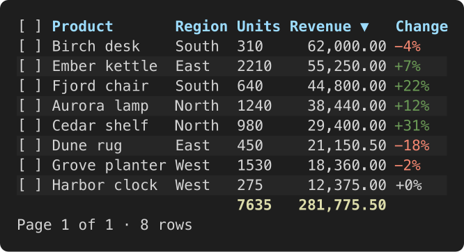

# vuistack-table

A TanStack-Table-style table component for Emacs: sorting, filtering, grouping, pagination and selection over plain plist rows, built on vui.el.



A table component for [vui.el](https://github.com/d12frosted/vui.el) that
works like [TanStack Table](https://tanstack.com/table) in Emacs. It
renders plist rows with zebra striping, money and signed-number cells,
KPI-rule indicator cells, multi-line cell renderers (sparklines, charts)
and cell actions. It also has TanStack's features: multi-sorting,
column and global filtering (including fuzzy), faceting, grouping with
aggregation, expanding sub-rows and detail panels, pagination, row
selection and pinning, column visibility, ordering, pinning and sizing,
header groups, footers, cell spanning and cell selection.

[TANSTACK-PARITY.md](TANSTACK-PARITY.md) lists every TanStack feature
with a link to its docs page and says how vuistack-table does it (or why
it does not apply in Emacs).

Requires Emacs 30.1 and [vui.el](https://github.com/d12frosted/vui.el) 1.4 or newer. It depends on nothing else.

## Install

```elisp
(use-package vuistack-table
  :vc (:url "https://github.com/davidawad/vuistack-table"))
```

Or clone it, add the directory to `load-path`, and `(require 'vuistack-table)`.

## Use

```elisp
(require 'vuistack-table)

(vui-mount
 (vui-component 'vuistack-table
   :id 'accounts
   :columns '((:header "Account" :key :name)
              (:header "Kind" :key :kind)
              (:header "Balance" :key :balance :money t :sign-color t
               :aggregation sum :footer aggregate))
   :rows '((:name "Cash" :kind "asset" :balance 1200)
           (:name "Card" :kind "liability" :balance -310.5))
   :zebra t
   :page-size 25
   :enable-row-selection t)
 "*accounts*")
```

Turn on `vuistack-table-mode` in that buffer for these keys. They act on
the table, row or cell at point.

| Key | Command |
| --- | --- |
| `S` | Sort by the column. Press again to reverse, a third time to clear. `C-u S` adds the column to a multi-sort. |
| `/` | Global filter. `column: text` searches one column. |
| `C-c C-f` | Clear the global filter. |
| `f` | Filter this column. Completion offers the column's values with their counts. |
| `F` | Clear every filter. |
| `H` / `V` | Hide the column / show or hide any column by name. |
| `<` / `>` | Move the column left / right. |
| `\|` | Pin the column left, then right, then unpin it. |
| `{` / `}` | Scroll the unpinned columns. |
| `+` / `-` / `=` | Widen / narrow the column (takes a count) / reset widths. |
| `G` | Group by the column. Press it on more columns to nest groups. |
| `x` / `X` | Expand or collapse the row / every row. |
| `m` / `M` / `U` | Select the row (`C-u m` selects a range) / all filtered rows (`C-u M` this page only) / clear the selection. |
| `T` / `B` | Pin the row to the top / bottom. |
| `]` / `[` / `#` | Next / previous page (`C-u` for last / first) / set the page size. |
| `c` / `C` / `w` | Start a cell range (`C-u c` adds a range, `C-u C-u c` excludes one) / extend it / copy it as TSV. |
| `E` | Edit the cell (needs the column's `:on-edit`). |
| `C-c C-r` | Reset the table to its `:initial-state`. |
| `C-c C-d` | Show the table's state. |

## Filter queries

`/` and `f` read the same small language. Each form maps to one of
TanStack's filter functions.

| Query | Matches |
| --- | --- |
| `text` | cells containing the text, ignoring case |
| `=text` / `==text` | cells equal to the text, ignoring case / exactly |
| `^text` / `text$` | cells starting / ending with the text |
| `>N` `>=N` `<N` `<=N` | numbers |
| `LO..HI` | numbers or dates in the range, inclusive (either end may be left off) |
| `=` / `!=` | empty / not empty |
| `all:a,b` / `any:a,b` | list values containing all / any of the items |
| `~text` | fuzzy match; a fuzzy global filter also ranks the rows |

## Props

| Prop | Meaning |
| --- | --- |
| `:id` | Names the table for its state (default `default`). Give each table in a buffer its own ID. |
| `:columns` | List of column specs (below). A spec with `:columns` is a header group. |
| `:rows` | List of row plists. `:total t` or `:emphasis t` rows render bold. `:sub-rows` nests rows. |
| `:zebra` | Stripe odd rows with `vuistack-table-stripe`. |
| `:empty` | Text shown when there are no rows (default `(no rows)`). |
| `:no-sort` | Leave out the column marks that the column commands read (cheaper for big tables). |
| `:no-header` | Drop the heading lines. |
| `:sticky-header` | Keep the column heading in `header-line-format` while the window is scrolled into this table's body. The heading follows native horizontal scroll and composes with an existing header line. |
| `:action` | `(ROW -> any)`, what `vuistack-table-activate` calls on a cell whose column has no `:action`. |
| `:initial-state` | Starting state, e.g. `(:sort ("Balance" . t) :hidden (:kind) :grouping (:kind) :page-size 10)`. Columns may be named by index, `:id`, `:key` or header. |
| `:on-state-change` | `(ID STATE)`, called after every change. Use it for server-side tables. |
| `:row-id` | `(ROW -> id)`. The default id is the row's index path, `"0"`, `"0.1"`, ... |
| `:get-sub-rows` | `(ROW -> rows)`. The default reads the row's `:sub-rows`. |
| `:detail` | `(ROW -> string)`, a panel drawn under an expanded row. |
| `:row-can-expand` | `(ROW -> bool)`, which rows can open a `:detail` panel. |
| `:page-size` | Turns on pagination at this many rows per page. |
| `:no-paginate-expanded-rows` | Keep a row's expanded children on its page instead of counting them toward the page size. |
| `:enable-row-selection` | `t` or `(ROW -> bool)`. Adds the `[x]` selection gutter. |
| `:single-select` | Select at most one row. |
| `:disable-sub-row-selection` | Selecting a parent does not select its children. |
| `:enable-row-pinning` / `:disable-row-pinning` | `(ROW -> bool)` decides which rows may be pinned / no row pinning at all. |
| `:drop-filtered-pinned-rows` | Hide pinned rows that the filters remove. |
| `:filter-from-leaf-rows` | Keep a parent when any of its descendants passes the filters. |
| `:max-leaf-row-filter-depth` | Rows deeper than this are not filtered. |
| `:global-filter-fn` | `(ROW QUERY -> bool)` in place of the built-in global filter. |
| `:grouped-column-mode` | `reorder` (default: grouped columns first), `remove` or `keep`. |
| `:max-multi-sort-count`, `:disable-multi-sort`, `:disable-sort-removal` | Limits on sorting. |
| `:manual-sorting`, `:manual-filtering`, `:manual-grouping`, `:manual-pagination`, `:manual-expanding` | Keep the state and the UI but leave the rows as given (server-side). With manual pagination, `:row-count` or `:page-count` gives the size. |
| `:auto-reset` | New rows reset the page and the expanded rows. |

## Column spec

| Key | Meaning |
| --- | --- |
| `:header` | Column heading. |
| `:id` | Column id (default `:key`, then `:header`). |
| `:key` / `:get` / `:path` | Read the cell from the row plist, with `(ROW -> value)`, or down a deep path like `(:address :city)`. |
| `:format` | `(VALUE -> string)`. |
| `:money` | Grouped two-decimal money, right-aligned. |
| `:align` | `right` right-aligns the cell and its heading. |
| `:sign-color` | Positive and negative numbers get `vuistack-table-positive` / `-negative`. |
| `:indicator` | `(ROW -> JUDGMENT)`. Colors the cell by the KPI rules below. |
| `:cell` | `(ROW WIDTH -> string)` renderer. It may return several lines. `vuistack-table-eas-cell` draws an [eas.el](https://github.com/davidawad/eas.el) chart. |
| `:action` | `(ROW -> any)` called by `vuistack-table-activate` on this cell. |
| `:width`, `:min-width`, `:max-width` | Width. The default is the widest cell, at most `vuistack-table-max-auto-width`. |
| `:hidden` | Start hidden. |
| `:sort-fn` | `alphanumeric`, `alphanumeric-case-sensitive`, `text`, `text-case-sensitive`, `datetime`, `basic`, or `(A B -> integer)`. |
| `:sort-desc-first`, `:invert-sorting`, `:sort-undefined` | Start descending / flip the order / put nil values `first` or `last`. |
| `:filter-fn` | A name from `vuistack-table-filter-functions` or `(VALUE QUERY ROW -> bool)`. |
| `:aggregation` | `sum`, `count`, `min`, `max`, `extent`, `mean`, `median`, `unique`, `unique-count`, `first`, `last`, `auto`, a function `(VALUES ROWS)`, or a list of these. Fills group rows. |
| `:aggregated-format` | `(VALUE -> string)` for the aggregated cell. |
| `:grouping-value` | `(ROW -> key)` to group by. |
| `:footer` | A string, `(ROWS -> string)`, or `aggregate` for the column's aggregation over the filtered rows. |
| `:span-rows` | `t` merges runs of equal values; `(ANCHOR VALUE -> bool)` sets custom runs. |
| `:span-columns` | `N` or `(ROW -> N)`: the cell takes N columns (summary rows). |
| `:row-number` | Show the row's display index. |
| `:on-edit` | `(ROW TEXT -> any)`, what `E` calls to edit the cell. |
| `:disable-sort`, `:disable-filter`, `:disable-global-filter`, `:disable-hide`, `:disable-pin`, `:disable-resize`, `:disable-group` | Turn one feature off for this column. |

## KPI-rule indicator cells

A JUDGMENT is `good`, `bad` or `neutral`, or a plist `(:judgment J
:metric-class C)` or `(:direction D :delta N :metric-class C)`.
The direction and delta decide the judgment. A rise is good for
`higher_is_better` (or `up`) and a fall is good for `lower_is_better`
(or `down`). `target`, `hold`, a missing direction and no movement are
all neutral. The metric class picks the face:

- `goal`: `vuistack-table-good` / `vuistack-table-bad`
- `guardrail` (the default for indicator cells): bold
  `vuistack-table-guardrail-pass` / `vuistack-table-guardrail-breach`
- `operational`: never colored

## State and reading a table back

Each table's state is a plist. `vuistack-table-state` reads it and
`vuistack-table-set-state` writes it. Its keys are `:sort :filter
:column-filters :hidden :order :pin-left :pin-right :widths :scroll
:grouping :expanded :selected :pin-top :pin-bottom :page :page-size
:cell-ranges`. With `:pin-left` set, native Emacs horizontal scrolling
keeps those left columns visible using window-local display overlays;
right-pinned columns remain part of the normal horizontal scroll.
The pure row model is `vuistack-table-row-model`.

Each line carries text properties: its row plist as `vuistack-table-row`
(read it with `vuistack-table-row-at-point`), its row-model node as
`vuistack-table-node`, and its table as `vuistack-table-id` and
`vuistack-table-columns`. These functions read a table back:

- `vuistack-table-selected-rows`
- `vuistack-table-get-row`
- `vuistack-table-selected-cells` and `vuistack-table-selected-cell-data`
- `vuistack-table-faceted-unique-values`, `vuistack-table-faceted-min-max`
  and `vuistack-table-global-faceted-unique-values`
- `vuistack-table-aggregate-column`

## Develop

```sh
make deps      # clones vui.el into .deps/ (git-ignored)
make compile   # byte-compile, warnings are errors
make test      # ERT suites
```

## License

MIT. See `LICENSE`.
